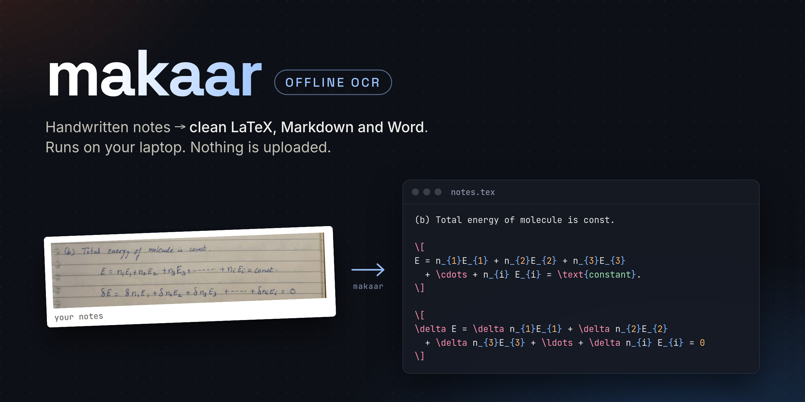

**Photos of your notes in; Markdown, LaTeX and Word out, with real equations. It runs on your own computer, so nothing is uploaded.**

Handwritten or printed pages and PDFs all work. Blocks the model is unsure of are marked in red so you can check them.

[**Download for Windows**](https://github.com/Satyanshgaur/makaar/releases/download/v0.1.0/makaar_0.1.0_x64-setup.exe) · [**Linux**](https://github.com/Satyanshgaur/makaar/releases/download/v0.1.0/makaar_0.1.0_amd64.AppImage) · [**macOS (Apple silicon)**](https://github.com/Satyanshgaur/makaar/releases/download/v0.1.0/makaar_0.1.0_aarch64.dmg) · [all files](https://github.com/Satyanshgaur/makaar/releases/latest) · [**makaar.sbs**](https://makaar.sbs)

## Works in 3 easy steps

After [installing](#install), it goes like this:

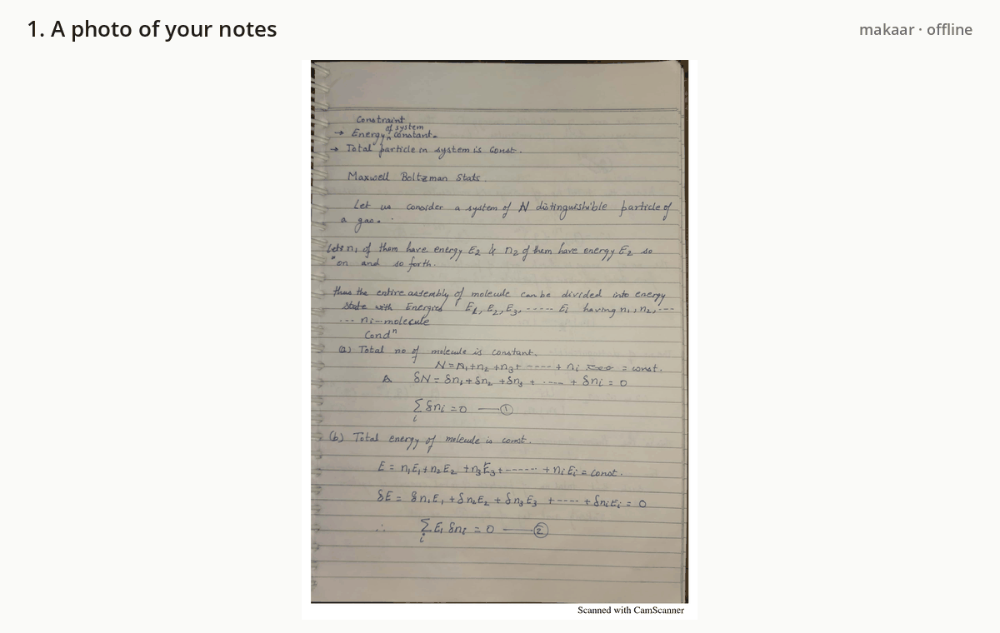


**1. Choose your pages.** Images or PDFs, or a whole folder. **If they are handwritten, tick _Handwritten notes_**: it is more accurate on handwriting and no slower. The first time, it downloads a 48 MB add-on. Leave it off for printed pages.

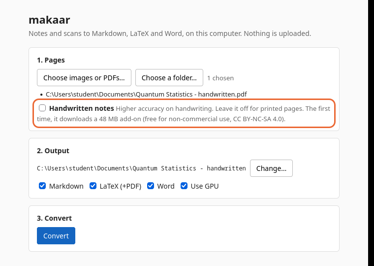

**2. Convert.** Each page shows up as it is done. The output folder gets `notes.md`, `notes.tex` (and a PDF if [Tectonic](https://tectonic-typesetting.github.io) is installed), `notes.docx` and `notes.json`.

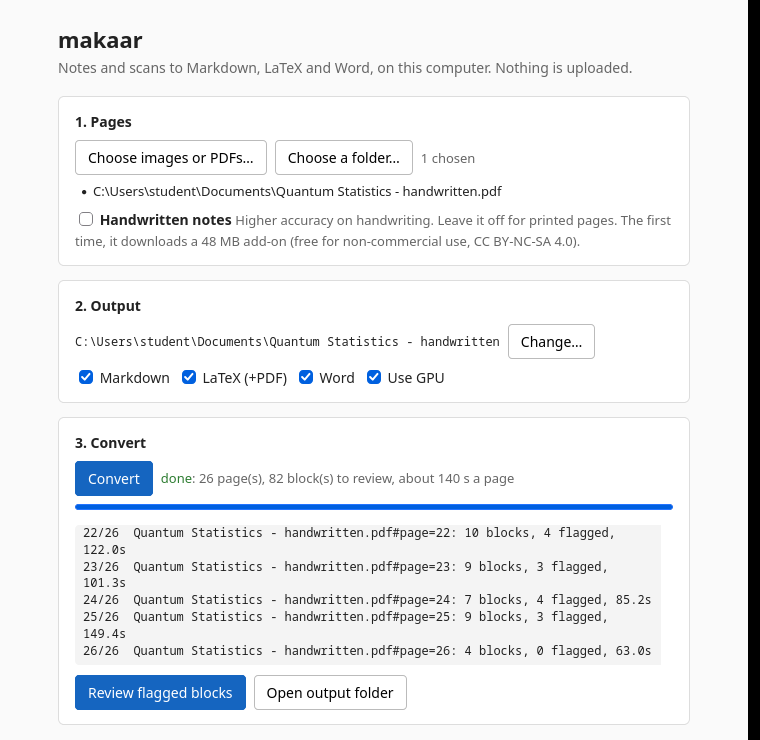

**3. Review.** *Review flagged blocks* shows the scan beside what was read. Red boxes are worth a look; equations preview as they will appear in Word. Fix what's wrong, then press *Save & export* to rewrite every file.

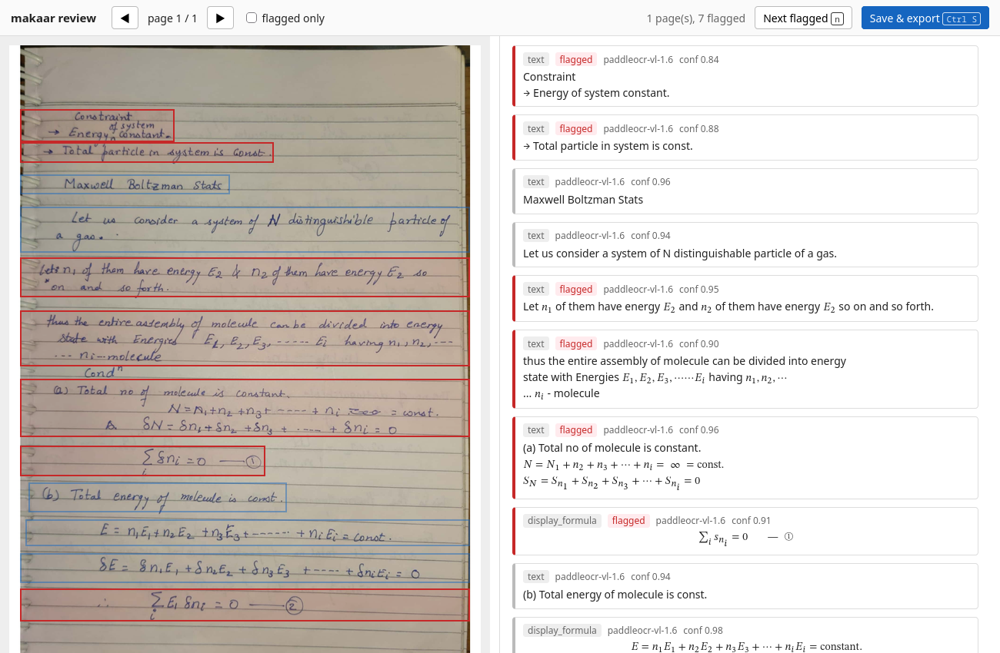

## Handwriting in, clean Markdown out

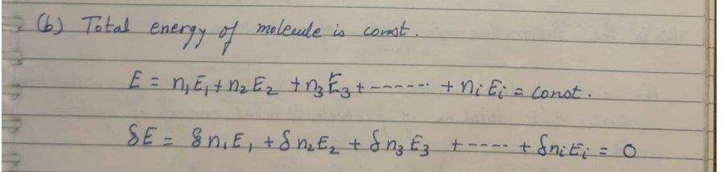

makaar writes, unedited:

```markdown
(b) Total energy of molecule is const.

$$
E = n_{1}E_{1} + n_{2}E_{2} + n_{3}E_{3} + \cdots + n_{i} E_{i} = \text{constant}.
$$

$$
\delta E = \delta n_{1}E_{1} + \delta n_{2}E_{2} + \delta n_{3}E_{3} + \ldots + \delta n_{i} E_{i} = 0
$$
```

which renders as:

(b) Total energy of molecule is const.

$$
E = n_{1}E_{1} + n_{2}E_{2} + n_{3}E_{3} + \cdots + n_{i} E_{i} = \text{constant}.
$$

$$
\delta E = \delta n_{1}E_{1} + \delta n_{2}E_{2} + \delta n_{3}E_{3} + \ldots + \delta n_{i} E_{i} = 0
$$

The same page also comes out as a Word document with editable equations, and as LaTeX.

## How accurate

<picture>
  <source media="(prefers-color-scheme: dark)" srcset="docs/img/accuracy-dark.png">
  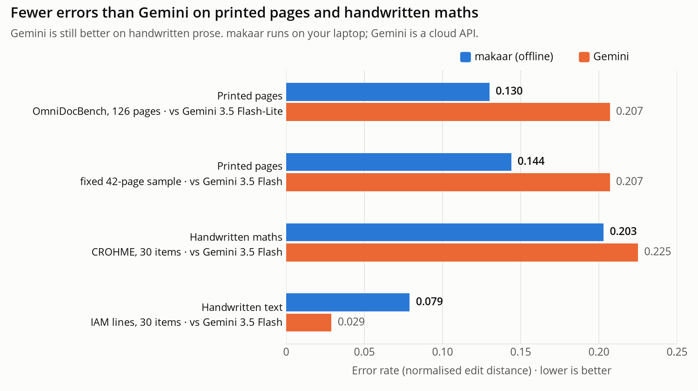
</picture>

Error rate is normalised edit distance: the share of characters you would have to fix. makaar was in handwritten mode for the handwriting rows. The handwriting samples are small, so read those two rows as "about level on maths, clearly behind on prose". Full tables and method: [`docs/RESULTS.md`](docs/RESULTS.md).

## How fast

<picture>
  <source media="(prefers-color-scheme: dark)" srcset="docs/img/speed-dark.png">
  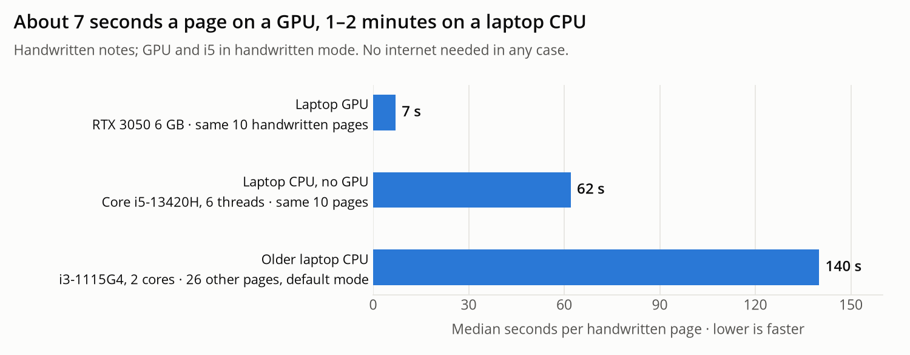
</picture>

The desktop app currently runs on the CPU only. The GPU figure is from the command line with a GPU build of llama.cpp (see [Command line](#command-line)). Printed pages are faster than handwriting.

## Install

The installers are not code-signed yet, so your system will warn you the first time.

**Windows 10/11**
1. Download [`makaar_0.1.0_x64-setup.exe`](https://github.com/Satyanshgaur/makaar/releases/download/v0.1.0/makaar_0.1.0_x64-setup.exe) and open it.
2. Windows says *The publisher could not be verified*. Click **Run**. If you see a blue "Windows protected your PC" screen instead, click **More info**, then **Run anyway**.

   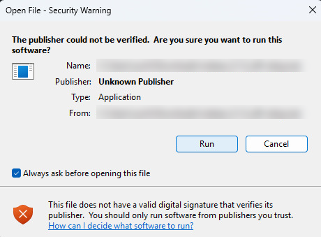
3. Keep the suggested folder and click **Next**. makaar installs for your user only, so it doesn't need administrator rights.

   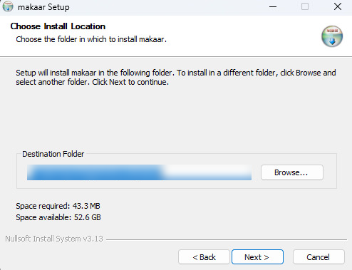
4. Click **Finish** with *Run makaar* ticked. There is also a desktop shortcut.

   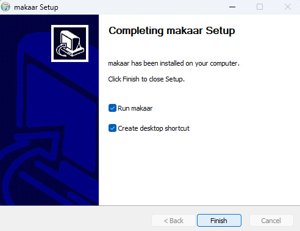

**Linux** (x64)
- AppImage, any distribution: download [`makaar_0.1.0_amd64.AppImage`](https://github.com/Satyanshgaur/makaar/releases/download/v0.1.0/makaar_0.1.0_amd64.AppImage), then
  ```
  chmod +x makaar_0.1.0_amd64.AppImage
  ./makaar_0.1.0_amd64.AppImage
  ```
  On Ubuntu 24.04, install FUSE first if it complains: `sudo apt install libfuse2t64`.
- Debian or Ubuntu package: download [`makaar_0.1.0_amd64.deb`](https://github.com/Satyanshgaur/makaar/releases/download/v0.1.0/makaar_0.1.0_amd64.deb), run `sudo apt install ./makaar_0.1.0_amd64.deb`, then start makaar from your applications menu.

**macOS** (Apple silicon)
1. Open [`makaar_0.1.0_aarch64.dmg`](https://github.com/Satyanshgaur/makaar/releases/download/v0.1.0/makaar_0.1.0_aarch64.dmg) and drag makaar to Applications.
2. The first time, right-click makaar and choose **Open**. Alternatively, go to *System Settings → Privacy & Security* and click **Open Anyway**.

**First start:** makaar asks to download its reading models: about 1.9 GB, once, checked with SHA-256. After that it works offline.

## Command line

The `makaar` CLI does the same job and is in [the release](https://github.com/Satyanshgaur/makaar/releases/latest) for Linux, macOS and Windows. You can also build it:

```
cargo build --release --manifest-path core/Cargo.toml
core/target/release/makaar setup                     # models (~1.9 GB) + llama.cpp's llama-server, SHA-256 checked
core/target/release/makaar convert scans/ -o out/    # out/notes.{md,tex,pdf,docx,json}
core/target/release/makaar review out/notes.json     # fix flagged blocks in the browser; saving re-exports
```

`setup` installs llama.cpp's official CPU build for your platform; `--backend vulkan` uses most laptop GPUs. You can also use your own `llama-server` (on PATH or `$MAKAAR_LLAMA_SERVER`), for example a CUDA build for NVIDIA cards. `tectonic` is optional and enables the LaTeX compile check. Use `--gpu-layers 0` for CPU only. Rerun the same command to resume an interrupted job.

`setup --handwriting-adapter` fetches the handwriting add-on ([satyansh0/makaar-handwriting-lora](https://huggingface.co/satyansh0/makaar-handwriting-lora), 48 MB), and `convert --handwritten` uses it on every block. Leave it off for printed pages, where it can restyle maths.

Found a problem? [Open an issue](https://github.com/Satyanshgaur/makaar/issues/new?template=beta-feedback.md) and paste the `speed:` line that `convert` prints. Beta testers: see [`docs/BETA.md`](docs/BETA.md).

## For developers

- `core/`: Rust core and the `makaar` CLI. It holds the document model, resumable queue, ingest, layout (PP-DocLayoutV3 on ONNX Runtime), recognition through a llama-server sidecar, exports and model download.
- `desktop/`: Tauri app over the same core. Build installers with `cd desktop && cargo tauri build` (Linux needs `webkit2gtk4.1-devel`).
- `eval/`: evaluation harness (`cd eval && uv run pytest`).
- `schema/document.schema.json`: the job document (pages → blocks) shared by the review screen and the exports.
- `docs/research.md` holds the research and build plan, and `docs/DECISIONS.md` records where we diverged from it.

## License

makaar's code is Apache 2.0 (`LICENSE`). The reading models it downloads, PaddleOCR-VL 1.6, PP-DocLayoutV3 and PP-OCRv6, are Apache 2.0. The optional handwriting add-on is CC BY-NC-SA 4.0, for non-commercial use only, because of its training data (see `DATASETS.md`).
